# Quorvia

Quorvia is a full-stack survey platform for building dynamic forms, collecting responses, and analyzing how users interact with conditional question flows.

The project focuses on implementing a non-trivial form engine rather than a simple CRUD application. Forms support conditional branching, multiple response modes, autosaved attempts, funnel analytics, asynchronous exports, and a React host integrated with a Vue 3 analytics micro-frontend.

## Screenshots

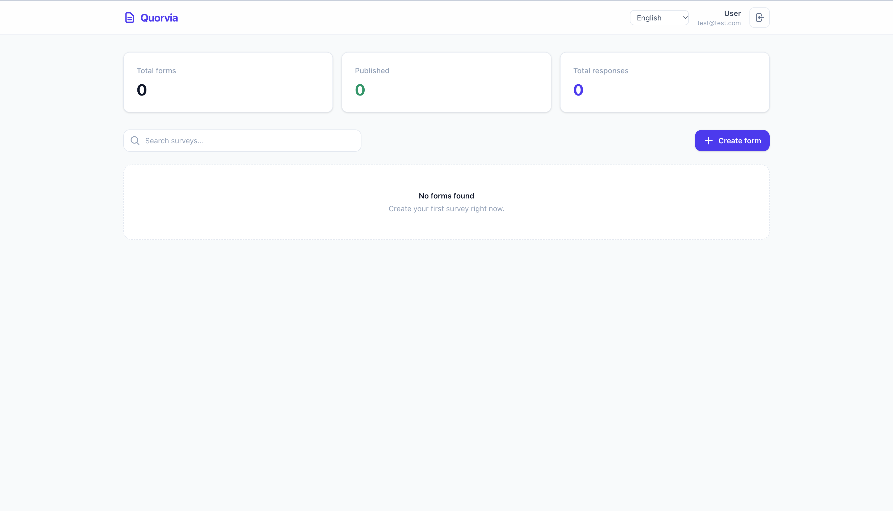
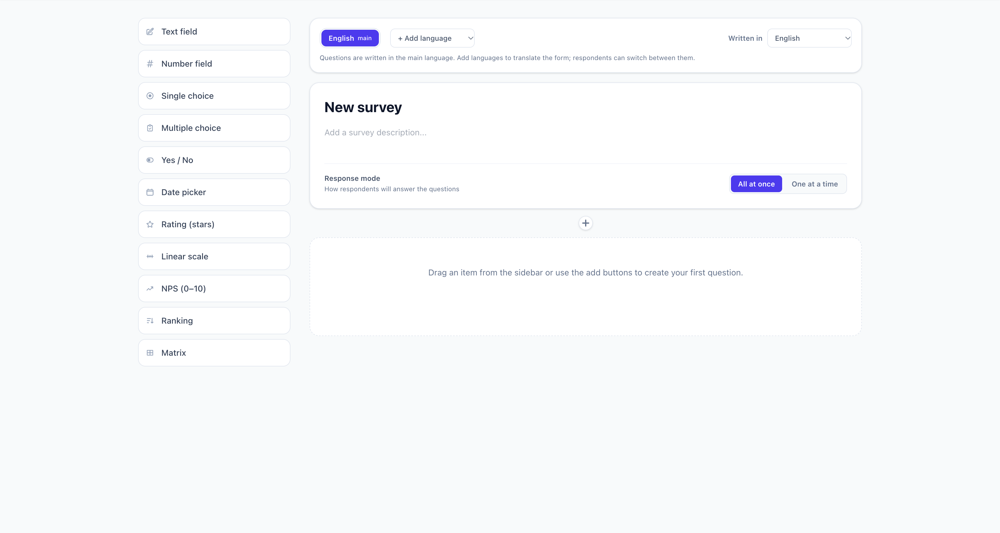

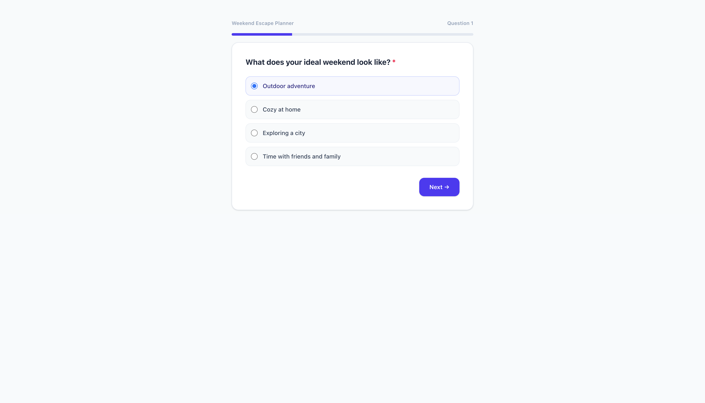
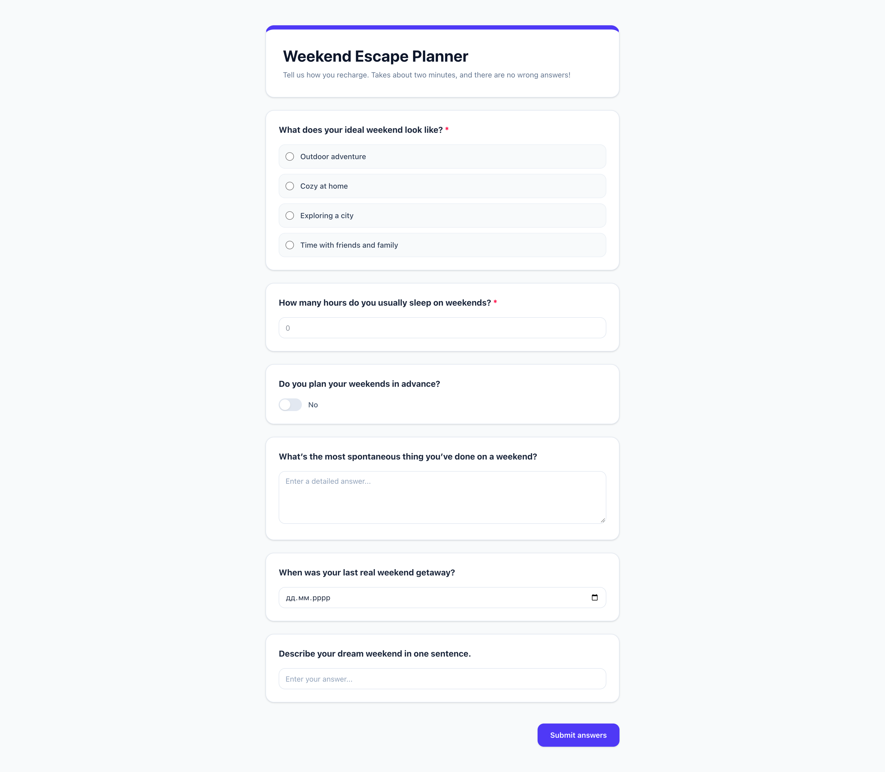
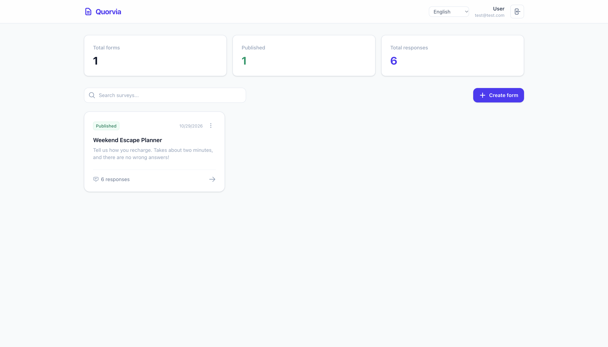
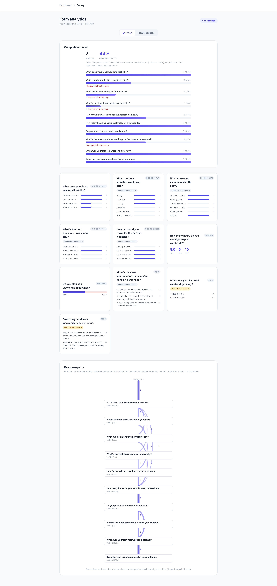
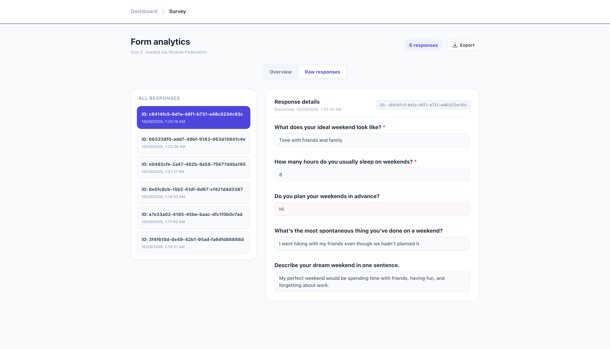

## Highlights

- Dynamic form builder with multiple question types
- Conditional question visibility with `AND` / `OR` rules
- Graph validation and cycle detection for conditional dependencies
- Server-side validation of conditional logic and submitted answers
- Step-by-step and all-at-once form completion modes
- Autosaved response attempts
- Funnel analytics based on questions users actually reached
- Branch/path analytics for conditional forms
- PDF, CSV, and Excel exports processed asynchronously
- BullMQ background worker with retry support
- React application with Vue 3 analytics micro-frontend
- Module Federation integration between React and Vue
- Shared TypeScript contracts across applications
- Dedicated framework-agnostic conditional logic engine
- Unit and integration tests with Vitest
- Docker-based local PostgreSQL and Redis infrastructure
- Security hardening: ReDoS-safe validation (RE2), rate limiting, refresh-token rotation with reuse detection, CSV-injection protection (see [Security](#security))
- pnpm monorepo

---

## Product Overview

Quorvia consists of three main user flows.

### Form Builder

Authenticated users can create and manage forms, configure questions, define conditional rules, reorder questions and options, and publish forms.

Supported question types include:

- Text
- Number
- Boolean
- Date
- Single choice
- Multiple choice

Questions can optionally depend on answers to previous questions.

Example:

```text
Q1. Do you have a driving license?
        │
        ├── Yes ──→ Q2. How many years have you been driving?
        │
        └── No  ──→ Q3. Are you planning to get one?
```

### Form Viewer

Published forms can be completed either:

- all at once;
- question by question.

Conditional questions are evaluated dynamically based on the respondent's answers.

### Analytics

The analytics module provides more than simple response aggregation.

It tracks:

- total attempts;
- completed responses;
- completion rate;
- questions actually reached;
- skipped questions;
- hidden questions;
- branching paths between questions.

The funnel is calculated from autosaved `ResponseAttempt` records, allowing incomplete form sessions to be included in the analysis.

## Architecture

Quorvia is organized as a pnpm workspace containing multiple applications and shared domain packages.

```
Quorvia/
│
├── backend/
│   └── Express + TypeScript + Prisma
│
├── react-frontend/
│   └── React host application
│
├── vue-analytics/
│   └── Vue 3 Module Federation remote
│
├── packages/
│   ├── condition-engine/
│   │   └── Conditional logic domain package
│   │
│   └── shared-types/
│       └── Shared DTOs and contracts
│
└── docker-compose.yml
    ├── PostgreSQL
    └── Redis
```

### High-level architecture

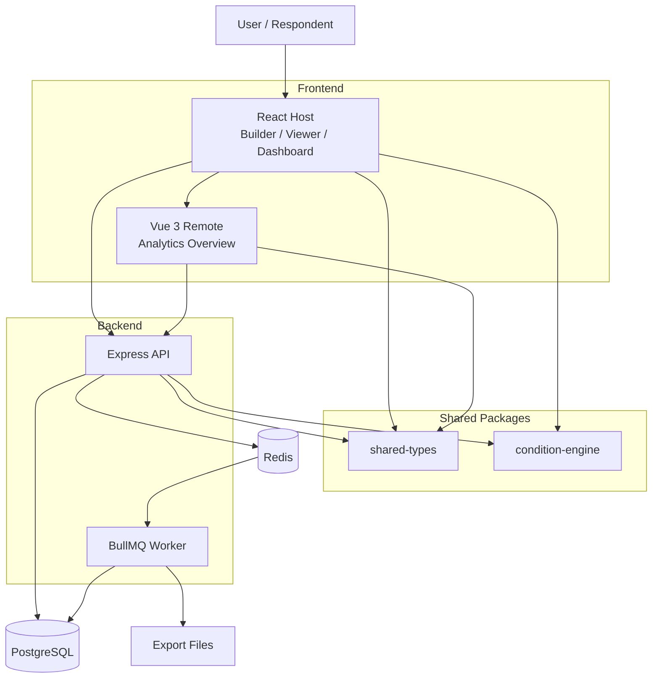

## Applications

### React Host

The main application is built with React and contains:

- authentication;
- dashboard;
- form builder;
- public form viewer;
- response analytics;
- raw responses;
- export management.

**Main technologies**

- React 19
- TypeScript
- React Router
- TanStack Query
- Zustand
- React Hook Form
- Zod
- Tailwind CSS
- Vite

**Client state architecture**

Server state and client/UI state are deliberately separated.

TanStack Query is responsible for server state:

- forms;
- responses;
- analytics;
- mutations;
- cache invalidation.

Zustand is used for local application state:

- authentication;
- builder state;
- transient UI state.

This avoids duplicating server data inside a global client store.

### Vue Analytics Micro-Frontend

The analytics Overview is implemented as a Vue 3 application and integrated into the React host using Module Federation.

```
React Host
    │
    │ Module Federation
    ▼
Vue Analytics Remote
    │
    ▼
Backend API
```

The Vue application is isolated from the React runtime: it has its own state, its own components and talks to the backend directly.

The React host mounts the Vue application when the analytics tab is activated and unmounts it when leaving the tab.

The only coupling is a small, explicit **auth bridge**. The access token lives in memory of the React host (it is not stored in `localStorage`), so the host passes two functions to the remote as props:

- `getAccessToken()` - returns the current access token;
- `refreshAccessToken()` - exchanges the httpOnly refresh cookie for a new token (it shares a single `/auth/refresh` request with the React side).

When the backend answers `401`, the Vue API client asks the host for a fresh token and retries the request once. If the session cannot be restored, the client dispatches an `AUTH_EXPIRED` browser event and the React host performs the logout.

Because a federated remote runs in the same page as the host, the remote's origin is a trusted code source - see [Security](#security) for the CSP that restricts it.

**Why Module Federation?**

The project intentionally demonstrates cross-framework integration rather than migrating the entire application to another framework.

Only the analytics Overview was implemented as a Vue remote.

This provides:

- framework isolation;
- independent build/deployment of the analytics application;
- the ability to introduce Vue into an existing React application incrementally;
- a realistic micro-frontend boundary.

This also introduces a deliberate trade-off: the Vue runtime is shipped separately from React, increasing bundle size.

The decision was therefore limited to a single feature boundary rather than turning the entire application into micro-frontends.

### Backend

The backend is a TypeScript API built with:

- Node.js
- Express
- Prisma
- PostgreSQL
- JWT authentication
- BullMQ
- Redis
- Zod

The backend is organized by domain modules rather than by technical layers only.

Conceptually:

```
backend/src/
│
├── modules/
│   ├── auth/
│   ├── form/
│   ├── response/
│   ├── attempt/
│   ├── analytics/
│   └── export/
│
├── shared/
│   ├── middleware/   (auth, validation, error handling, rate limiters)
│   ├── schemas/      (shared Zod schemas)
│   ├── queue/
│   └── utils/
│
└── prisma/
```

This keeps business logic close to the domain it belongs to while allowing shared infrastructure to remain separate.

## Conditional Logic Engine

Conditional logic is implemented as a standalone package:

```
packages/condition-engine/
```

The package exposes pure functions for:

- evaluating conditions;
- resolving visible questions;
- validating conditional dependencies;
- detecting invalid/cyclic graphs.

For example:

```ts
evaluateCondition(condition, answers)

resolveVisibleQuestionIds(questions, answers)

validateConditionGraph(questions)
```

The package is framework-independent and can therefore be used by both the frontend and backend.

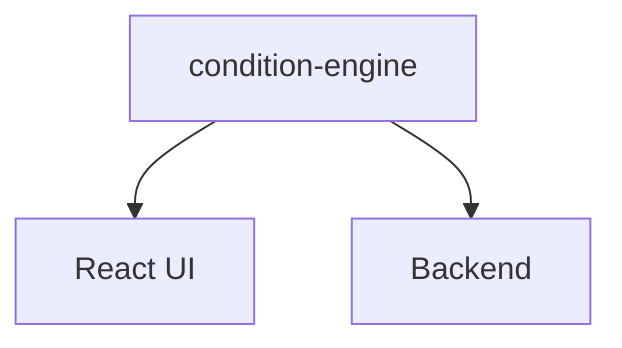

This avoids implementing the same business rule independently in multiple applications.

### Conditional Logic Architecture

A condition can contain multiple rules combined with `AND` or `OR`.

For example:

```
Show Q4 when:

Q1 == "yes"
AND
Q2 > 18
```

The evaluator determines whether a question should be visible based on the current answer set.

```
Questions + Answers
        │
        ▼
evaluateCondition()
        │
        ▼
resolveVisibleQuestionIds()
        │
        ▼
Visible questions
```

### Dependency Validation

Conditional questions are not allowed to create invalid dependency graphs.

The backend validates the condition graph before accepting form configuration.

The graph validation prevents invalid/cyclic dependencies and guarantees that conditional navigation remains deterministic.

For example:

Valid:

```
Q1 → Q2 → Q3 → Q4
```

An invalid configuration could create a dependency cycle:

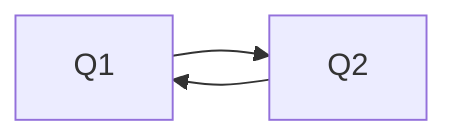

The condition editor also limits available operators based on the target question type.

For example, numeric `gt` / `lt` operators are exposed for `NUMBER` questions but not for `DATE` questions because the evaluator performs numeric comparisons.

The UI therefore does not expose combinations that the underlying evaluator cannot correctly process.

## Server-Side Security Invariants

Conditional visibility is not treated as a client-only UI concern.

The backend recalculates the visible questions when a response is submitted.

```
Client answers
      │
      ▼
Backend loads form
      │
      ▼
resolveVisibleQuestionIds()
      │
      ▼
Build validation schema
      │
      ▼
Validate answers
      │
      ▼
Remove answers belonging to hidden questions
      │
      ▼
Persist response
```

This is important because the client cannot be trusted to enforce conditional rules.

A malicious client cannot simply submit answers for questions that were hidden by the form's conditional logic.

The backend remains the source of truth for:

- question visibility;
- response validation;
- accepted answers.

## Security

This is a portfolio project, but it is built to be hardened the way a real survey platform would be. Public forms accept anonymous input, so the backend treats every request as untrusted.

### What is implemented

| Area | Measure |
| --- | --- |
| Authentication | bcrypt (cost 12); passwords limited to 72 bytes (bcrypt's real limit); emails normalized (trim + lowercase); constant-time-ish login (dummy hash when the user does not exist) |
| Sessions | Short-lived access JWT (15 min, `HS256` pinned for sign *and* verify); opaque refresh token in an httpOnly, path-restricted cookie; only its SHA-256 hash is stored |
| Refresh rotation | Atomic rotation (`updateMany ... WHERE revokedAt IS NULL`), so two parallel requests cannot both succeed; **reuse detection** revokes all of the user's tokens when an already-revoked token is replayed; hourly cleanup of expired/revoked tokens in the worker |
| Browser storage | The access token is kept **in memory only**; after a page reload the session is restored silently from the refresh cookie |
| Authorization | Every form/response/analytics/export endpoint checks ownership of the parent resource; child resources are verified to belong to the parent |
| Concurrent edits | `Form.version` is an optimistic lock: saving is a conditional `UPDATE ... WHERE version = N` that is the first action of the transaction, so a stale editor gets `409 FORM_VERSION_CONFLICT` instead of silently overwriting another tab's changes; the builder then offers to load the latest version. Publishing does not bump the version (it does not touch builder-edited content) |
| Input validation | Zod on every body; length/size limits on forms, questions, options and conditions; caps on `answers` (keys, string length, array size); bounded pagination (`limit <= 100`) |
| ReDoS | User-defined regex patterns are compiled with **RE2** (linear time) both at save time and at validation time; patterns RE2 cannot run (lookahead, backreferences) are rejected |
| Rate limiting | Per-IP: whole API, login/register, refresh; per-IP **and per form** for public submissions and autosave; per-user for export creation, plus a cap on concurrent exports |
| Exports | CSV formula injection neutralized (`=`, `+`, `-`, `@`, tab, CR); responses capped per export; workers store a stable error code, never raw error text |
| HTTP | `helmet`, explicit CORS allow-list (comma-separated `CORS_ORIGIN`), `trust proxy` configurable via `TRUST_PROXY`, malformed/oversized JSON answered with 400/413 |
| Config | In production the API refuses to start with a short or example `JWT_SECRET` or a `localhost` `CORS_ORIGIN` |
| Frontend | No `dangerouslySetInnerHTML` / `v-html`; production build ships a Content-Security-Policy `<meta>` that allows scripts only from the app and the Vue remote origin |
| Supply chain | Dependabot, CodeQL, `pnpm audit` job, least-privilege `GITHUB_TOKEN` in CI |
| Local infra | Postgres and Redis ports are published on `127.0.0.1` only |

### Data retention

The worker runs maintenance tasks on start and then periodically (all of them idempotent, so several worker instances only duplicate work):

| Task | Interval | What it removes |
| --- | --- | --- |
| `token-cleanup` | hourly | Expired or revoked refresh tokens (after a 7-day grace) |
| `export-cleanup` | daily | Export jobs older than `EXPORT_RETENTION_DAYS` together with their files, plus files in `uploads/exports` that have no database row (for example after a form was deleted - the cascade removes the rows, not the files) |
| `attempt-cleanup` | daily | **Unfinished** `ResponseAttempt` rows that started more than `ATTEMPT_RETENTION_DAYS` ago |

Design notes:

- Work is done in batches of 500, so neither the id lists nor the deletes grow with the table.
- Files are removed before their rows. A crash in between leaves a row without a file (downloads answer `410`, the next run removes the row) rather than a file nobody tracks. Stored file names are resolved inside the exports directory and anything that would escape it is ignored.
- Orphan files are only deleted when older than the retention period, so a file the worker has just written but not yet recorded is never touched. Files whose names do not look like `<job uuid>-<name>` are left alone.
- **Completed attempts are never deleted**: the funnel needs them. Deleting abandoned attempts does have a visible side effect - they stop counting towards `totalAttempts`, so the completion rate for the old period goes up. Set `ATTEMPT_RETENTION_DAYS=0` if you prefer exact historical numbers over table size. The cut-off uses `startedAt` (immutable, indexed) rather than `updatedAt`, which every autosave changes.

### Known gaps / deployment notes

- **Rate-limit state is in memory.** With more than one backend instance each one counts separately; use `rate-limit-redis` (Redis is already part of the stack).
- **Set `TRUST_PROXY`** (for example `1`) when running behind nginx, Render, Railway or similar. Without it every user shares the proxy's IP and therefore one rate limit.
- **Same-site deployment.** The refresh cookie is `SameSite=Lax`. Serve the frontend and the API from the same site (e.g. `app.example.com` and `api.example.com`); on unrelated domains the browser will not send the cookie and sessions will end after 15 minutes.
- **HTTP security headers for the frontend.** The CSP in the build is a `<meta>` tag, which cannot express `frame-ancestors`. Prefer sending a CSP header (plus `X-Content-Type-Options`, `Referrer-Policy`) from the static host. Set `VITE_DISABLE_CSP=true` to turn the meta tag off.
- **Exports live on local disk.** The worker writes files to `uploads/exports` and the API serves them from the same path, so both processes must see the same filesystem (a shared volume when they run in separate containers). Object storage would remove this constraint.
- **Motion.** Animations use [`motion`](https://motion.dev) in two weights, chosen by where the code lives. Toasts (in the always-loaded bundle) use `motion/mini` (WAAPI, ~3 kB gzip): they slide in, shrink and fade out, and a toast is removed from the DOM only after its exit animation finished. The animation is a progressive enhancement - without WAAPI, or if it fails, the toast simply appears and disappears. The step-by-step question flow (in the lazy public-form chunk, so only respondents download it) uses `AnimatePresence` + `LazyMotion`/`domAnimation` (~28 kB gzip in motion 14): steps slide in the direction of travel, the outgoing step is `inert` while it leaves so a stale button cannot be clicked, and focus moves to the new step's heading when it mounts. `MotionConfig reducedMotion="user"` and a `prefers-reduced-motion` check remove the movement and keep only the fade. Tests skip animations (`MotionGlobalConfig.skipAnimations`) or mock them. `motion` is pinned to an exact version at least two weeks old.
- **Failure handling in the browser.** A render or lazy-chunk error on any page shows a localized error screen (router `errorElement`) instead of a blank page; if the Vue remote cannot be loaded the analytics page shows a fallback with a reload button (a failed dynamic `import()` is cached by the browser, so reloading is more reliable than retrying in place). Analytics requests that depend on changing input (page, selected response/question) use a *latest wins* guard with `AbortController`, so a slow old response cannot overwrite a newer one.
- **The Vue remote is trusted code.** It runs inside the React page with access to the in-memory token. Host it under your control and keep `VITE_VUE_ANALYTICS_URL` pointing only to it.
- **Analytics reads responses in batches, not all at once.** Overview, paths, funnel and per-question analytics walk a form's responses with keyset pagination (2,000 rows per query, ordered by `createdAt, id` and served by the `(formId, createdAt, id)` index) and aggregate incrementally, so memory is bounded by the batch size. Time is still linear in the number of responses, because every request re-scans them; for very large forms the next step is caching with a short TTL or pre-aggregated counters. Free-text questions are capped (top 5 / top 100 values and the first 1,000 raw answers, flagged by `answersTruncated`), and at most 10,000 distinct text values per question are tracked.
- **Export size limit.** Exports are limited to 20,000 responses because the worker builds files in memory; streaming exporters would remove the limit.
- **Redis has no password** in the local Docker setup (it is bound to loopback). Use authentication and TLS for any shared environment.
- Not implemented: email verification, password reset, account lockout, CAPTCHA/bot protection on public forms, audit log, GitHub Actions pinned to commit SHAs.

## Response Attempts and Funnel Analytics

A regular `Response` only represents a completed submission.

That is insufficient for meaningful funnel analytics because users can abandon a form before submitting it.

Quorvia therefore separates:

```
ResponseAttempt
    ↓
Autosaved progress

Response
    ↓
Completed submission
```

`ResponseAttempt` stores the questions the respondent actually **reached** during the session.

This allows analytics to answer:

> How many respondents actually reached this question?

instead of only:

> How many completed responses contain an answer for this question?

**Funnel calculation**

```
ResponseAttempt
      │
      ├── reachedQuestionIds
      └── completedAt
              │
              ▼
        Funnel calculation
              │
              ├── total attempts
              ├── completions
              ├── completion rate
              └── reached count per question
```

An attempt is considered to have reached a question if that question appears in its `reachedQuestionIds`.

`reached` is deliberately **not** the same as `visible`:

- **visible** (`visibleQuestionIds`) - the question is logically eligible to be shown right now, given the current answers. Every question without a condition is visible from the very first autosave, even if the respondent is still on step one.
- **reached** (`reachedQuestionIds`) - the respondent really saw the question at least once. It is a grow-only set: if a respondent answers Q1 = Yes, sees Q2, then goes back and changes Q1 to No, Q2 is hidden again but stays reached.

In step-by-step mode the client sends the exact list of questions it displayed; in all-at-once mode every currently visible question is on screen, so the server uses the visible set. Unknown ids are discarded. The set is merged with the stored value atomically in one SQL statement (`INSERT ... ON CONFLICT DO UPDATE` with a `jsonb` union), so out-of-order or parallel autosave requests cannot shrink it. Submitting the form also adds every question of the final response to the attempt. The list comes from the client, so a tampered request can only skew the funnel of the respondent's own form, like a forged submission would.

Attempts created before `reachedQuestionIds` existed fall back to `visibleQuestionIds` until they are saved again.

### Analytics Model

The analytics system distinguishes between:

**Reached**
The respondent actually encountered the question.

**Answered**
The respondent provided an answer.

**Skipped**
The question was visible but no answer was provided.

**Hidden**
The question was not shown because its condition evaluated to false.

This makes analytics meaningful for branching forms instead of treating every question as if it were displayed to every respondent.

## Asynchronous Export Pipeline

PDF, CSV, and Excel exports are processed asynchronously.

Large or potentially expensive export operations are not performed directly inside the HTTP request.

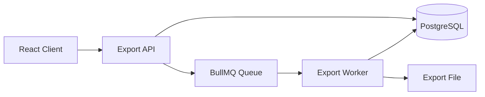

The lifecycle is:

```
PENDING
   │
   ▼
PROCESSING
   │
   ├──→ COMPLETED
   │
   └──→ FAILED
```

The worker uses a concurrency limit and delegates format-specific generation to exporters.

Conceptually:

```
Export Worker
     │
     └── exportersByFormat
            ├── PDF exporter
            ├── CSV exporter
            └── Excel exporter
```

Errors are persisted on the export job and re-thrown so BullMQ can apply its retry behavior.

The frontend polls only while an export job is still in a non-final state and stops polling once all jobs are completed or failed.

## Shared Types

The workspace contains a shared package:

```
packages/shared-types/
```

It provides common contracts used by the applications.

This reduces contract drift between:

```
React
   │
Vue
   │
Backend
```

and keeps API-related types consistent across the monorepo.

## Data Flow

### Form Submission

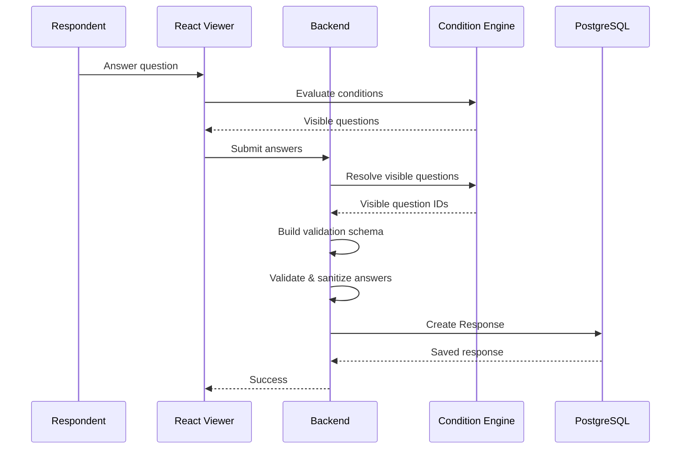

### Analytics

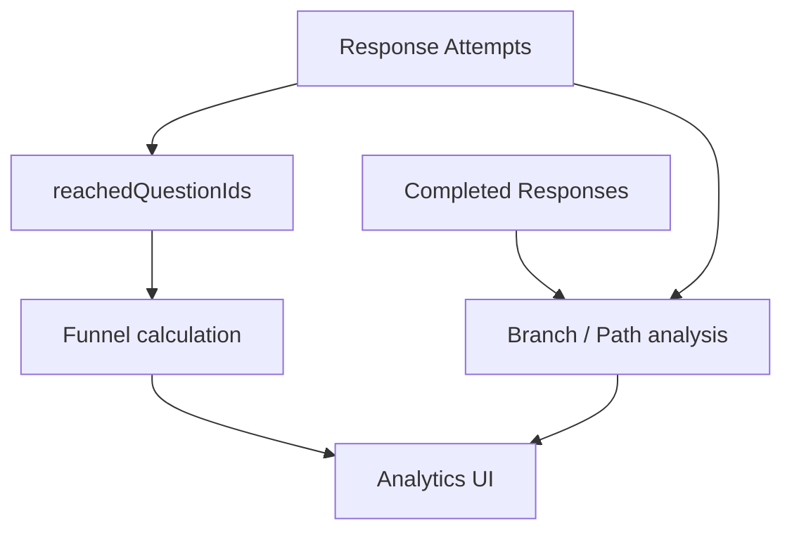

## Project Structure

```
Quorvia/
│
├── backend/
│   ├── src/
│   │   ├── modules/
│   │   │   ├── auth/
│   │   │   ├── form/
│   │   │   ├── response/
│   │   │   ├── attempt/
│   │   │   ├── analytics/
│   │   │   └── export/
│   │   │
│   │   ├── shared/
│   │   └── prisma/
│   │
│   └── package.json
│
├── react-frontend/
│   ├── src/
│   │   ├── api/
│   │   ├── pages/
│   │   │   ├── dashboard/
│   │   │   ├── builder/
│   │   │   ├── viewer/
│   │   │   └── analytics/
│   │   ├── store/
│   │   └── components/
│   │
│   └── package.json
│
├── vue-analytics/
│   ├── src/
│   └── package.json
│
├── packages/
│   ├── condition-engine/
│   └── shared-types/
│
├── docs/
│   └── API.md
├── docker-compose.yml
├── package.json
└── pnpm-workspace.yaml
```

## API

A short reference of all endpoints is in [docs/API.md](docs/API.md).

## Technology Stack

| Area                 | Technology               |
| --------------------- | ------------------------- |
| Language              | TypeScript                |
| Frontend              | React 19                  |
| Routing               | React Router               |
| Server state          | TanStack Query             |
| Client state          | Zustand                   |
| Forms                 | React Hook Form            |
| Validation            | Zod                        |
| Styling               | Tailwind CSS               |
| Frontend build        | Vite                       |
| Analytics             | Vue 3                      |
| Micro-frontends       | Module Federation          |
| Backend               | Node.js + Express          |
| ORM                   | Prisma                     |
| Database              | PostgreSQL                 |
| Authentication        | JWT                        |
| Background jobs       | BullMQ                     |
| Queue / cache         | Redis                      |
| Monorepo              | pnpm workspaces             |
| Testing               | Vitest + Testing Library    |
| Local infrastructure  | Docker Compose              |

## Testing

The project uses automated tests for both pure domain logic and application behavior.

### Condition Engine

The conditional logic package is tested independently because it contains framework-independent business rules.

Examples include:

- empty conditions;
- equality / inequality;
- numeric comparisons;
- AND / OR rules;
- visible question resolution;
- invalid condition graphs;
- cyclic dependencies.

```bash
pnpm --filter @quorvia/condition-engine test
```

### Backend

Backend tests cover:

- authorization and ownership checks;
- response validation;
- conditional visibility;
- funnel analytics;
- export processing;
- exporter behavior;
- error handling.

```bash
pnpm test:backend
```

### Frontend

React and Vue tests cover important UI behavior and state transitions using Vitest and Testing Library.

Run the complete workspace test suite:

```bash
pnpm test
```

## Local Development

### Requirements

- Node.js 20+
- pnpm 9+
- Docker

The repository uses pnpm workspaces.

```bash
git clone <repository-url>
cd Quorvia

pnpm install
```

If pnpm asks for permission to run package build scripts:

```bash
pnpm approve-builds
```

### Start Infrastructure

PostgreSQL and Redis are provided through Docker Compose.

```bash
pnpm docker:up
```

To reset the local infrastructure:

```bash
pnpm docker:reset
```

To stop it:

```bash
pnpm docker:down
```

### Environment Variables

Create the environment files from the templates (`.env.example` files are tracked in git):

```bash
cp .env.example .env                    # used by docker-compose.yml
cp backend/.env.example backend/.env
```

Backend variables:

| Variable | Required | Description |
| --- | --- | --- |
| `DATABASE_URL` | yes | PostgreSQL connection string |
| `REDIS_URL` | yes | Redis connection string (BullMQ) |
| `JWT_SECRET` | yes | Access-token signing secret. In production it must be at least 32 characters and must not be the example value (`openssl rand -base64 48`) |
| `CORS_ORIGIN` | no | Allowed frontend origin(s), comma-separated. Default `http://localhost:5173`; must not be `localhost` in production |
| `PORT` | no | API port, default `5001` |
| `TRUST_PROXY` | no | Number of reverse proxies in front of the API (`1` for one proxy). Required for correct per-IP rate limiting behind a proxy |
| `NODE_ENV` | no | `production` enables the stricter checks above and `Secure` cookies |
| `EXPORT_RETENTION_DAYS` | no | How long finished exports (file + `ExportJob` row) are kept. Default `7`, minimum `1` |
| `ATTEMPT_RETENTION_DAYS` | no | How long **unfinished** attempts are kept. Default `180`; `0` keeps them forever. See [Data retention](#data-retention) |

The React application can optionally use:

```dotenv
VITE_API_URL=http://localhost:5001/api
VITE_VUE_ANALYTICS_URL=http://localhost:5174
# VITE_DISABLE_CSP=true   # turns off the production CSP <meta> tag
```

`VITE_API_URL` and `VITE_VUE_ANALYTICS_URL` are also used to build the production Content-Security-Policy, so set them at build time.

### Database

Run Prisma migrations:

```bash
cd backend

npx prisma migrate dev
npx prisma generate
```

> The `20261028000000_normalize_user_emails` migration lowercases existing user emails. If two accounts differ only by letter case it fails on the unique constraint - merge those accounts manually first.

### Start the Applications

**Backend**

```bash
pnpm dev:backend
```

**React Frontend**

```bash
pnpm dev:frontend
```

**Background Worker**

```bash
pnpm dev:worker
```

### Vue Analytics

The Vue remote requires a production build to generate `remoteEntry.js`:

```bash
pnpm --filter vue-analytics build
pnpm --filter vue-analytics preview
```

The React application can then load the remote from the configured `VITE_VUE_ANALYTICS_URL`.

## Architecture Decisions

The following decisions were intentional trade-offs rather than framework defaults.

**1. Keep Conditional Logic Framework-Independent**

Instead of implementing conditional logic separately in React, Vue, and the backend, it lives in a dedicated package.

Benefit: one domain implementation can be reused across multiple applications.

**2. Re-evaluate Visibility on the Server**

The frontend is responsible for user experience, but the backend owns the final validation.

Benefit: clients cannot bypass conditional rules by manually submitting hidden fields.

**3. Separate Attempts from Completed Responses**

A completed response is not enough to build a real funnel.

Benefit: autosaved attempts allow analytics to include respondents who never submitted the form.

**4. Use Module Federation Only at a Meaningful Boundary**

The entire application was not split into micro-frontends.

Instead, the analytics Overview was isolated as a Vue remote.

Benefit: the architecture demonstrates cross-framework integration while avoiding unnecessary micro-frontend boundaries.

Trade-off: React and Vue runtimes are separate, increasing the amount of JavaScript delivered to the browser.

**5. Move Exports to Background Jobs**

Export generation can be CPU- and I/O-intensive and should not block an HTTP request.

Benefit: the API remains responsive while exports are processed asynchronously.

**6. Separate Server State from UI State**

TanStack Query manages remote data while Zustand manages local application state.

Benefit: server cache management, invalidation, and UI state remain separate concerns.

## Trade-offs and Limitations

Quorvia intentionally prioritizes architectural demonstration and domain complexity over production infrastructure completeness.

Some areas that would require additional work for a production deployment include:

- object storage instead of local export files;
- distributed file cleanup and retention policies;
- production secrets management;
- observability and centralized logging;
- shared (Redis-backed) rate limiting for multi-instance deployments;
- the remaining items from [Known gaps](#known-gaps--deployment-notes);
- horizontal worker scaling;
- more advanced authorization policies;
- production deployment configuration for the Vue remote;
- more comprehensive end-to-end testing against deployed infrastructure.

These are deployment concerns rather than core architectural requirements of the project.

## What This Project Demonstrates

Quorvia was built to demonstrate end-to-end ownership of a non-trivial product feature across multiple layers of a modern web application.

The most important engineering aspects are:

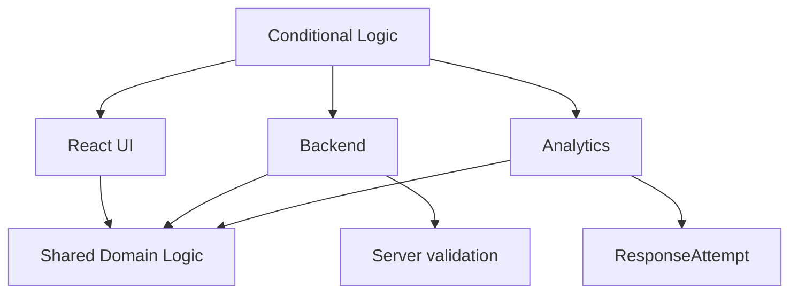

The project combines:

- domain-driven conditional logic;
- graph validation;
- server-side security invariants;
- shared TypeScript contracts;
- React and Vue integration;
- Module Federation;
- asynchronous background processing;
- PostgreSQL persistence;
- Redis/BullMQ infrastructure;
- automated testing.

The goal was not to build the largest possible application, but to demonstrate how a complex product feature can be designed and implemented consistently across the frontend, backend, data model, and infrastructure.
