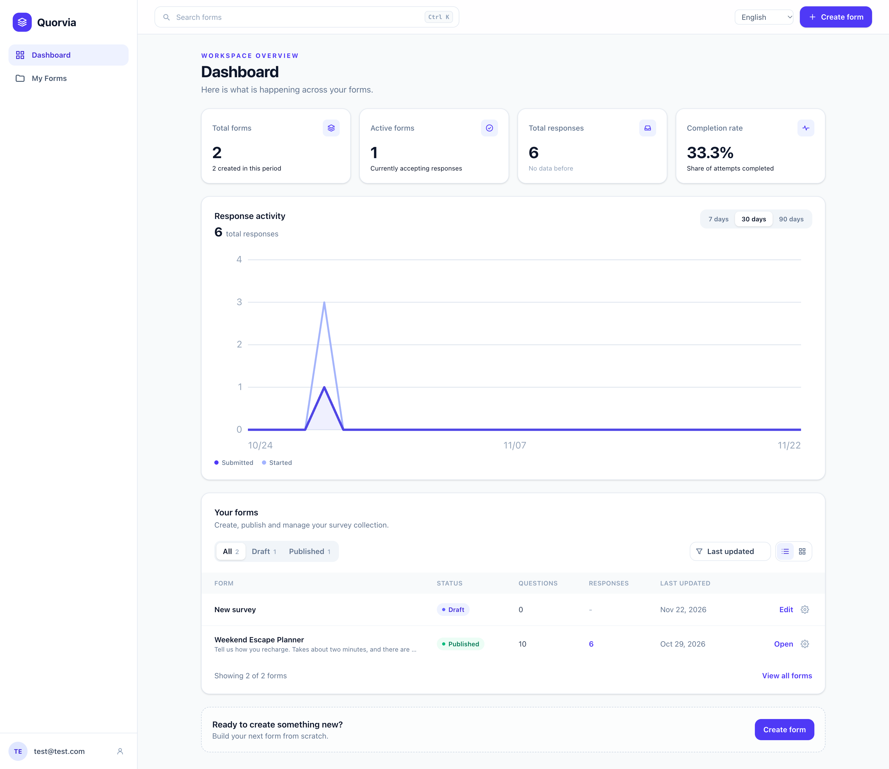
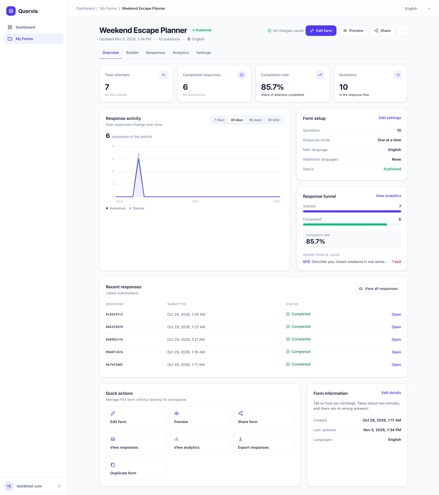
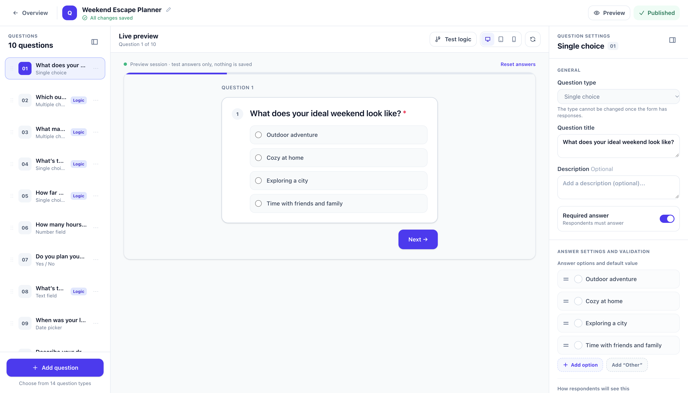
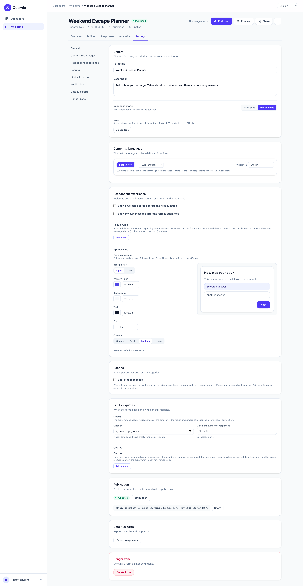
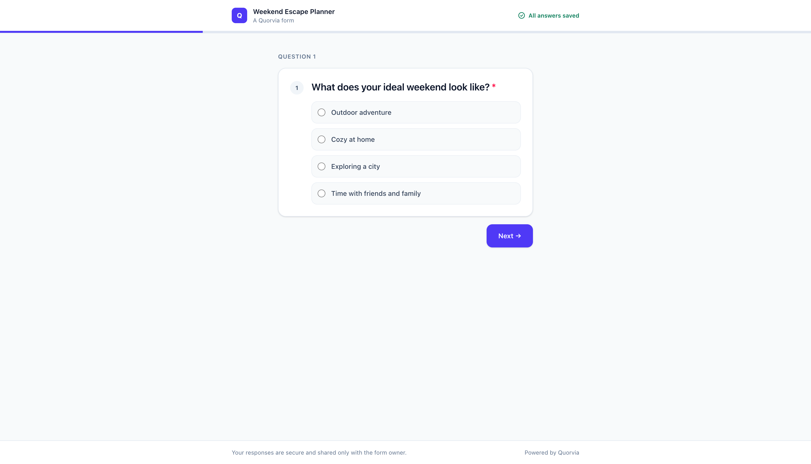
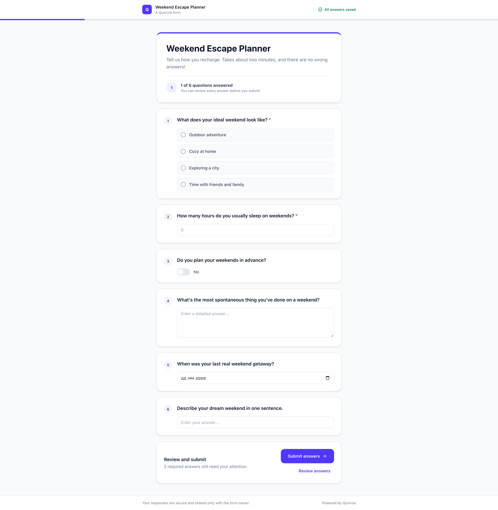
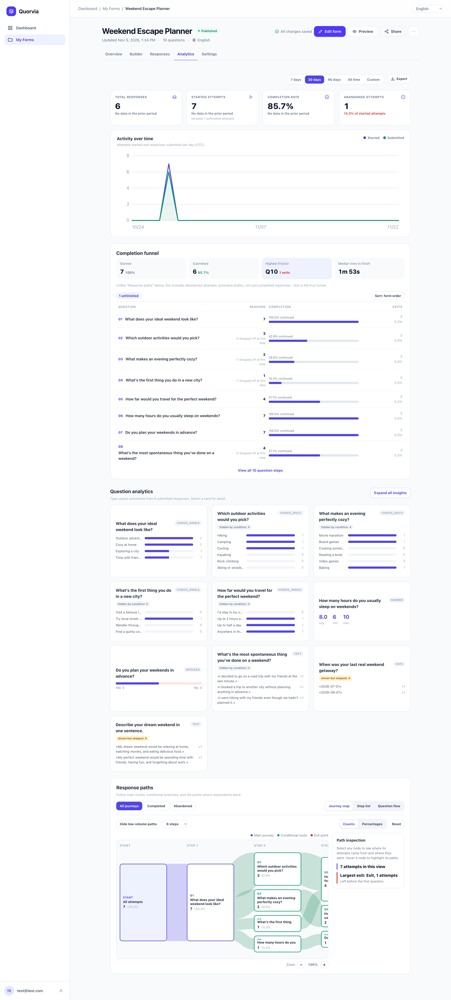

# Quorvia

Quorvia is a full-stack survey platform for building dynamic forms, collecting responses, and analyzing how respondents move through conditional question flows.

The project focuses on a non-trivial form engine rather than plain CRUD: conditional branching, several response modes, autosaved attempts, funnel analytics, asynchronous exports, translated forms, and a React host integrated with a Vue 3 analytics micro-frontend.

## Screenshots










## Features

**Form builder**

- 14 question types: text, number, boolean, date, single and multiple choice (with an optional “Other” answer), image choice, star rating, linear scale, NPS, ranking, matrix (including Likert statements), file upload, and calculation fields
- Conditional question visibility with `AND` / `OR` rules, graph validation and cycle detection
- Welcome and end screens, with conditional end screens (result rules): a different message and redirect depending on the answers, decided on the server
- Quotas: a limit of completed responses per group of respondents, kept atomically on the server, with an early warning while the form is being filled
- Scoring: points for answers, a total and result categories, written into the end screen and used to choose it, with a score histogram in the analytics and score columns in the exports
- Drag-and-drop reordering of questions and options, optimistic locking against concurrent edits
- Form content in several languages: a main language plus up to 10 translations, with missing-translation indicators

**Respondents**

- Step-by-step and all-at-once completion modes, in one shared page frame (header with the form name, progress bar, save status, language pill)
- Autosaved attempts with a live “saved” indicator
- A review screen before submitting in **both** modes: step-by-step opens it after the last question, the all-at-once form opens it from “Review answers”; every answer is shown as text with an “Edit” button back to its question
- Language chosen from `?lang=`, the browser, or a switcher

**Workspace**

- A dashboard (totals over all forms with the change against the previous period, response activity, the latest forms) and a full "My forms" list with search, status filter, sorting and list/card views
- A workspace for every form with Overview, Builder, Responses, Analytics and Settings; one editable draft is shared by all of them, with one explicit save and an optimistic version lock
- The Overview shows the form's health: readiness for publishing, attempts vs. completed responses, completion rate, response activity, funnel snapshot, recent responses, sharing (with a link per language) and asynchronous exports
- A three-column Builder: the question list (drag and drop, "+" between questions, all question types), a live preview that uses the public form's own components (both modes, branching, the welcome screen, desktop/tablet/mobile) and an inspector with every setting of the selected question, including its translations; moves and deletions that would break a condition are explained, never applied silently
- Form-wide settings (languages, screens, appearance, scoring, quotas, publication) in Settings

**Public site**

- A landing page at `/` that presents the product (features, use cases, how it works) in the interface language; signed-in users get a “Dashboard” button instead of “Get started”

**Analytics and exports**

- Funnel analytics based on the questions respondents actually reached, with exits per question and the median time to finish
- A period filter (7 / 30 / 90 days, all time, custom) for the whole overview, KPI cards compared with the previous period and an activity trend
- A journey map (Sankey) built from attempts: branches, exits and outcomes, filterable (all / completed / abandoned), with a path inspector, a step list for phones, and the classic question-flow view
- Per-type summaries: distributions and averages for scales, NPS breakdown, average ranking position, matrix tables
- PDF, CSV and Excel exports processed asynchronously by a BullMQ worker with retries

**Engineering**

- Server-side validation of conditional logic and submitted answers
- Dedicated framework-agnostic condition engine shared by the frontend and the backend
- React host with a Vue 3 analytics micro-frontend (Module Federation)
- Shared TypeScript contracts, exhaustive `switch` checks over question types
- Security hardening: RE2-based regex validation, rate limiting, refresh-token rotation with reuse detection, CSV-injection protection
- Vitest unit and integration tests, pnpm monorepo, Docker-based PostgreSQL and Redis

## Documentation

| Document                                       | Contents                                                                              |
| ---------------------------------------------- | ------------------------------------------------------------------------------------- |
| [Architecture](docs/architecture.md)           | Monorepo layout, high-level diagram, data flow, design decisions, trade-offs          |
| [Frontend](docs/frontend.md)                   | React host, Vue micro-frontend, landing page, public form viewer, performance, motion |
| [Conditional logic](docs/conditional-logic.md) | The condition engine, dependency validation, server-side invariants                   |
| [Calculation fields](docs/calculation.md)      | Formula language, exact decimals, editor, live value, exports and analytics           |
| [Question types](docs/question-types.md)       | Supported types and the checklist for adding a new one                                |
| [Content languages](docs/content-languages.md) | Translating forms and how respondents pick a language                                 |
| [Analytics](docs/analytics.md)                 | Attempts, reached vs. visible questions, funnel and per-type analytics                |
| [Exports](docs/exports.md)                     | The asynchronous export pipeline                                                      |
| [Security](docs/security.md)                   | Implemented measures, data retention, known gaps and deployment notes                 |
| [API](docs/API.md)                             | Endpoint reference                                                                    |
| [Local development](docs/development.md)       | Setup, environment variables, running and testing                                     |

## Quick start

Requirements: Node.js 20+, pnpm 9+, Docker.

```bash
pnpm install
cp .env.example .env
cp backend/.env.example backend/.env

pnpm docker:up                      # PostgreSQL and Redis
(cd backend && npx prisma migrate dev)

pnpm dev:backend
pnpm dev:worker
pnpm dev:frontend
```

The Vue analytics remote needs a production build; see [Local development](docs/development.md).

## Technology stack

| Area            | Technology                                                                                            |
| --------------- | ----------------------------------------------------------------------------------------------------- |
| Frontend        | React 19, TypeScript, React Router, TanStack Query, Zustand, React Hook Form, Zod, Tailwind CSS, Vite |
| Analytics UI    | Vue 3 via Module Federation                                                                           |
| Backend         | Node.js, Express, Prisma, PostgreSQL, JWT                                                             |
| Background jobs | BullMQ, Redis                                                                                         |
| Tooling         | pnpm workspaces, Vitest, Testing Library, Docker Compose                                              |
