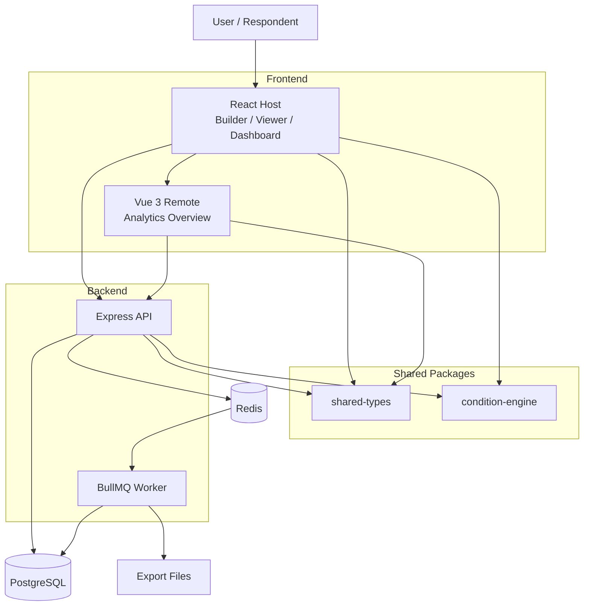
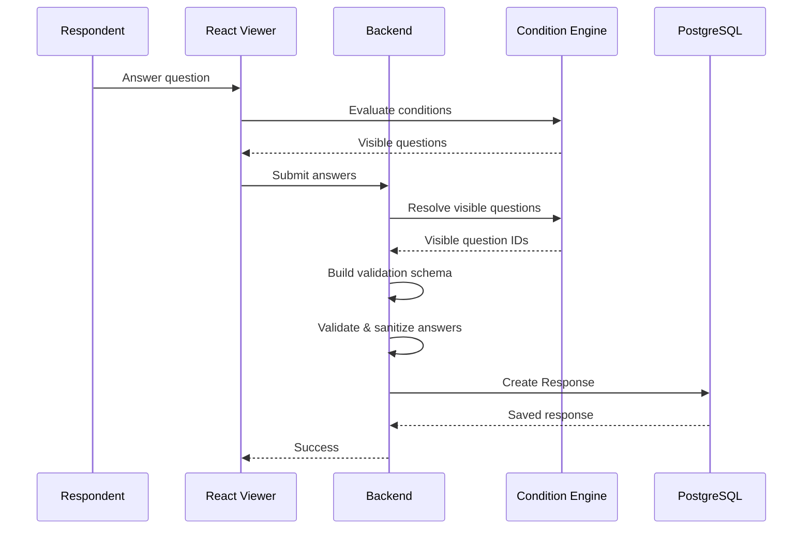
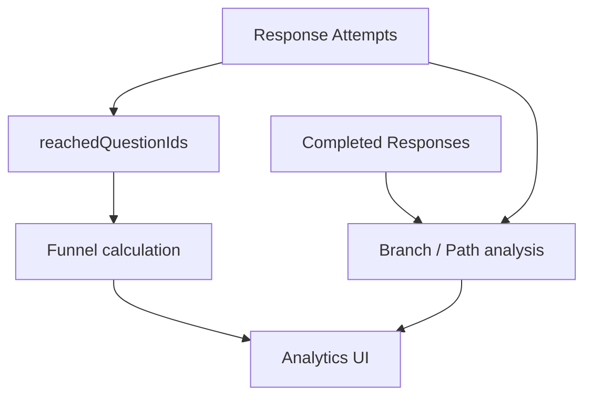
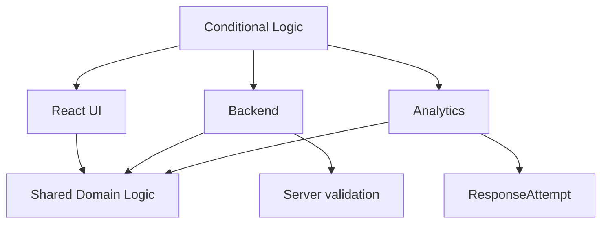

# Architecture

Quorvia is organized as a pnpm workspace containing multiple applications and shared domain packages.

```
Quorvia/
│
├── backend/
│   └── Express + TypeScript + Prisma
│
├── react-frontend/
│   └── React host application
│
├── vue-analytics/
│   └── Vue 3 Module Federation remote
│
├── packages/
│   ├── condition-engine/
│   │   └── Conditional logic domain package
│   │
│   └── shared-types/
│       └── Shared DTOs and contracts
│
└── docker-compose.yml
    ├── PostgreSQL
    └── Redis
```

## High-level architecture



## Backend

The backend is a TypeScript API built with:

- Node.js
- Express
- Prisma
- PostgreSQL
- JWT authentication
- BullMQ
- Redis
- Zod

The backend is organized by domain modules rather than by technical layers only.

Conceptually:

```
backend/src/
│
├── modules/
│   ├── auth/
│   ├── form/
│   ├── response/
│   ├── attempt/
│   ├── analytics/
│   └── export/
│
├── shared/
│   ├── middleware/   (auth, validation, error handling, rate limiters)
│   ├── schemas/      (shared Zod schemas)
│   ├── queue/
│   └── utils/
│
└── prisma/
```

This keeps business logic close to the domain it belongs to while allowing shared infrastructure to remain separate.

The frontend applications are described in [frontend.md](frontend.md).

## Shared Types

The workspace contains a shared package:

```
packages/shared-types/
```

It provides common contracts used by the applications.

This reduces contract drift between:

```
React
   │
Vue
   │
Backend
```

and keeps API-related types consistent across the monorepo.

## Data Flow

### Form submission



### Analytics



## Project Structure

```
Quorvia/
│
├── backend/
│   ├── src/
│   │   ├── modules/
│   │   │   ├── auth/
│   │   │   ├── form/
│   │   │   ├── response/
│   │   │   ├── attempt/
│   │   │   ├── analytics/
│   │   │   └── export/
│   │   │
│   │   ├── shared/
│   │   └── prisma/
│   │
│   └── package.json
│
├── react-frontend/
│   ├── src/
│   │   ├── api/
│   │   ├── pages/
│   │   │   ├── dashboard/
│   │   │   ├── builder/
│   │   │   ├── viewer/
│   │   │   └── analytics/
│   │   ├── store/
│   │   └── components/
│   │
│   └── package.json
│
├── vue-analytics/
│   ├── src/
│   └── package.json
│
├── packages/
│   ├── condition-engine/
│   └── shared-types/
│
├── docs/                (architecture, security, API, guides)
├── .github/            (CI, CodeQL, Dependabot)
├── docker-compose.yml
├── package.json
└── pnpm-workspace.yaml
```

## Architecture Decisions

The following decisions were intentional trade-offs rather than framework defaults.

**1. Keep Conditional Logic Framework-Independent**

Instead of implementing conditional logic separately in React, Vue, and the backend, it lives in a dedicated package.

Benefit: one domain implementation can be reused across multiple applications.

**2. Re-evaluate Visibility on the Server**

The frontend is responsible for user experience, but the backend owns the final validation.

Benefit: clients cannot bypass conditional rules by manually submitting hidden fields.

**3. Separate Attempts from Completed Responses**

A completed response is not enough to build a real funnel.

Benefit: autosaved attempts allow analytics to include respondents who never submitted the form.

**4. Use Module Federation Only at a Meaningful Boundary**

The entire application was not split into micro-frontends.

Instead, the analytics Overview was isolated as a Vue remote.

Benefit: the architecture demonstrates cross-framework integration while avoiding unnecessary micro-frontend boundaries.

Trade-off: React and Vue runtimes are separate, increasing the amount of JavaScript delivered to the browser.

**5. Move Exports to Background Jobs**

Export generation can be CPU- and I/O-intensive and should not block an HTTP request.

Benefit: the API remains responsive while exports are processed asynchronously.

**6. Separate Server State from UI State**

TanStack Query manages remote data while Zustand manages local application state.

Benefit: server cache management, invalidation, and UI state remain separate concerns.

## Trade-offs and Limitations

Quorvia intentionally prioritizes architectural demonstration and domain complexity over production infrastructure completeness.

Some areas that would require additional work for a production deployment include:

- object storage instead of local export files;
- distributed file cleanup and retention policies;
- production secrets management;
- observability and centralized logging;
- shared (Redis-backed) rate limiting for multi-instance deployments;
- the remaining items from [Known gaps](security.md#known-gaps--deployment-notes);
- horizontal worker scaling;
- more advanced authorization policies;
- production deployment configuration for the Vue remote;
- more comprehensive end-to-end testing against deployed infrastructure.

These are deployment concerns rather than core architectural requirements of the project.

## What This Project Demonstrates

Quorvia was built to demonstrate end-to-end ownership of a non-trivial product feature across multiple layers of a modern web application.

The most important engineering aspects are:



The project combines:

- domain-driven conditional logic;
- graph validation;
- server-side security invariants;
- shared TypeScript contracts;
- React and Vue integration;
- Module Federation;
- asynchronous background processing;
- PostgreSQL persistence;
- Redis/BullMQ infrastructure;
- automated testing.

The goal was not to build the largest possible application, but to demonstrate how a complex product feature can be designed and implemented consistently across the frontend, backend, data model, and infrastructure.
