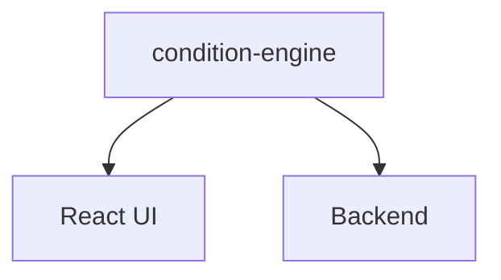
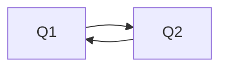

# Conditional Logic

Conditional logic is implemented as a standalone package:

```
packages/condition-engine/
```

The package exposes pure functions for:

- evaluating conditions;
- resolving visible questions;
- validating conditional dependencies;
- detecting invalid/cyclic graphs.

For example:

```ts
evaluateCondition(condition, answers)

resolveVisibleQuestionIds(questions, answers)

validateConditionGraph(questions)
```

The package is framework-independent and can therefore be used by both the frontend and backend.



This avoids implementing the same business rule independently in multiple applications.

## Architecture

A condition can contain multiple rules combined with `AND` or `OR`.

For example:

```
Show Q4 when:

Q1 == "yes"
AND
Q2 > 18
```

The evaluator determines whether a question should be visible based on the current answer set.

```
Questions + Answers
        │
        ▼
evaluateCondition()
        │
        ▼
resolveVisibleQuestionIds()
        │
        ▼
Visible questions
```

## Dependency Validation

Conditional questions are not allowed to create invalid dependency graphs.

The backend validates the condition graph before accepting form configuration.

The graph validation prevents invalid/cyclic dependencies and guarantees that conditional navigation remains deterministic.

For example:

Valid:

```
Q1 → Q2 → Q3 → Q4
```

An invalid configuration could create a dependency cycle:



The condition editor also limits available operators based on the target question type.

For example, numeric `gt` / `lt` operators are exposed for `NUMBER` questions but not for `DATE` questions because the evaluator performs numeric comparisons.

The UI therefore does not expose combinations that the underlying evaluator cannot correctly process.

## Which questions can be used in conditions

A condition compares the answer to an earlier question, so the builder only offers sources whose answers map to the simple operators:

| Question type | Operators |
| --- | --- |
| `TEXT` | `equals`, `notEquals`, `contains` |
| `NUMBER`, `RATING`, `SCALE`, `NPS` | `equals`, `notEquals`, `gt`, `lt` (the answer is a plain number, so `0` is a real value) |
| `DATE` | `equals`, `notEquals` |
| `BOOLEAN` | `equals` |
| `CHOICE_SINGLE` | `equals`, `notEquals`, `in` |
| `CHOICE_MULTI` | `contains` |
| `RANKING`, `MATRIX` | not available as a condition source |

See [question-types.md](question-types.md) and the [API reference](API.md#question-types) for the answer format of each type.

## Server-Side Invariants

Conditional visibility is not treated as a client-only UI concern.

The backend recalculates the visible questions when a response is submitted.

```
Client answers
      │
      ▼
Backend loads form
      │
      ▼
resolveVisibleQuestionIds()
      │
      ▼
Build validation schema
      │
      ▼
Validate answers
      │
      ▼
Remove answers belonging to hidden questions
      │
      ▼
Persist response
```

This is important because the client cannot be trusted to enforce conditional rules.

A malicious client cannot simply submit answers for questions that were hidden by the form's conditional logic.

The backend remains the source of truth for:

- question visibility;
- response validation;
- accepted answers.
