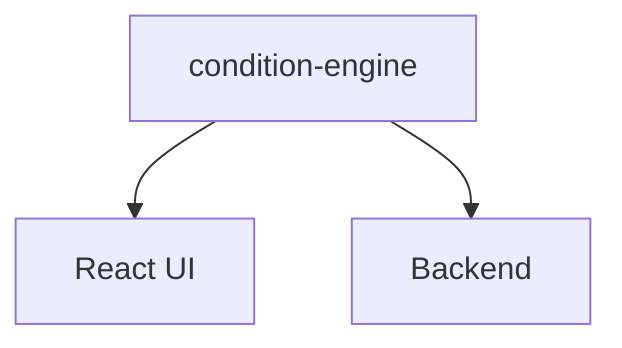
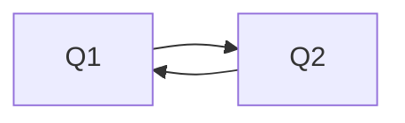

# Conditional Logic

Conditional logic is implemented as a standalone package:

```
packages/condition-engine/
```

The package exposes pure functions for:

- evaluating conditions;
- resolving visible questions;
- validating conditional dependencies;
- detecting invalid/cyclic graphs.

For example:

```ts
evaluateCondition(condition, answers);

resolveVisibleQuestionIds(questions, answers);

validateConditionGraph(questions);
```

The package is framework-independent and can therefore be used by both the frontend and backend.



This avoids implementing the same business rule independently in multiple applications.

## Architecture

A condition can contain multiple rules combined with `AND` or `OR`.

For example:

```
Show Q4 when:

Q1 == "yes"
AND
Q2 > 18
```

The evaluator determines whether a question should be visible based on the current answer set.

```
Questions + Answers
        │
        ▼
evaluateCondition()
        │
        ▼
resolveVisibleQuestionIds()
        │
        ▼
Visible questions
```

## Dependency Validation

Conditional questions are not allowed to create invalid dependency graphs.

The backend validates the condition graph before accepting form configuration.

The graph validation prevents invalid/cyclic dependencies and guarantees that conditional navigation remains deterministic.

For example:

Valid:

```
Q1 → Q2 → Q3 → Q4
```

An invalid configuration could create a dependency cycle:



The condition editor also limits available operators based on the target question type.

For example, numeric `gt` / `lt` operators are exposed for `NUMBER` questions but not for `DATE` questions because the evaluator performs numeric comparisons.

The UI therefore does not expose combinations that the underlying evaluator cannot correctly process.

## Which questions can be used in conditions

A condition compares the answer to an earlier question, so the builder only offers sources whose answers map to the simple operators:

| Question type                      | Operators                                                                                |
| ---------------------------------- | ---------------------------------------------------------------------------------------- |
| `TEXT`                             | `equals`, `notEquals`, `contains`                                                        |
| `NUMBER`, `RATING`, `SCALE`, `NPS` | `equals`, `notEquals`, `gt`, `lt` (the answer is a plain number, so `0` is a real value) |
| `DATE`                             | `equals`, `notEquals`                                                                    |
| `BOOLEAN`                          | `equals`                                                                                 |
| `CHOICE_SINGLE`                    | `equals`, `notEquals`, `in`                                                              |
| `CHOICE_MULTI`                     | `contains`                                                                               |
| `RANKING`, `MATRIX`                | not available as a condition source                                                      |

See [question-types.md](question-types.md) and the [API reference](API.md#question-types) for the answer format of each type.

## Conditional end screens (result rules)

The same condition shape also decides **what the respondent sees after submitting**. A form can have up to 10 _end rules_; each one is a condition (`logic` `AND` / `OR`, up to 50 rules with `questionId`, `operator`, `value`, exactly as for questions) plus an end screen (`text`, optional `redirectUrl`):

```json
{
  "endRules": [
    {
      "id": "high",
      "condition": {
        "logic": "AND",
        "rules": [{ "questionId": "q-satisfaction", "operator": "gt", "value": 7 }]
      },
      "screen": { "text": "Glad you liked it!", "redirectUrl": "https://example.com/thank-you" }
    },
    {
      "id": "low",
      "condition": {
        "logic": "AND",
        "rules": [{ "questionId": "q-satisfaction", "operator": "lt", "value": 5 }]
      },
      "screen": {
        "text": "Sorry to hear that.",
        "redirectUrl": "https://example.com/contact-support"
      }
    }
  ]
}
```

**Which screen is shown.** After a successful submit the server checks the rules **from top to bottom** and uses the first one whose condition holds. If none holds, the form's own `endScreen` applies, and without one the viewer shows its standard thank-you message. The order of the rules therefore matters, and the builder lets the author move them up and down.

**How a condition is evaluated** (`resolveEndScreen` in the backend):

- It is evaluated on the answers the server accepted, that is only the answers of **visible** questions (see below). A rule on a question the respondent was not shown does not hold, whatever the operator (without this, `notEquals` would be true for a hidden question, because there is no answer to be equal to).
- For a visible question the respondent skipped, the operators behave as for question conditions: `equals`, `gt`, `lt`, `in`, `contains` do not hold, `notEquals` does.
- Unlike the condition of a question, a rule may look at **any** question: it is evaluated after the whole form was answered, so there is no ordering requirement and no dependency graph or cycle check.
- Rules on `RANKING`, `MATRIX` and `FILE` questions are not allowed (their answer does not reduce to the simple operators; see the table above).

**Validation on save.** `PATCH /forms/:formId` checks the rules against the question list of the _same_ request. A rule on a question that does not exist, or whose type cannot be compared, is refused with `400 FORM_INVALID_END_RULES` (`errors` lists `{ ruleId, questionId, reason }`, reason `UNKNOWN_QUESTION` or `UNSUPPORTED_QUESTION_TYPE`) and nothing is written. This also means a question that a stored rule still looks at cannot be deleted until the rule is changed or removed. Rules that are malformed by the time of a submit (which validation prevents) are ignored instead of failing the submission.

**What is stored and what is exposed**

- The rules live in `Form.endRules`. The winning rule's id is stored on the response as `Response.endRuleId` (`null` when none matched or for responses from before end rules existed), so the outcomes can be told apart later.
- The rules are **never part of the public form**, and their translated texts are removed from the public `translations`: the respondent must not be able to read the thresholds (for example `score > 7`) or the other outcomes. Only the chosen screen, in the respondent's language, is returned by `POST /forms/:shareId/responses` as `endScreen`.
- Duplicating a form copies the rules and points them at the copied questions (the same remapping as for question conditions).
- In the builder an unfinished rule (no message, or a condition without a value) is not saved, and saving is blocked while a rule points at a deleted question.

## Quotas

A quota limits how many **completed responses** can come from a group of respondents, for example "at most 50 answers from Kyiv". A form can have up to 20 quotas. Each has a name (for the owner), a condition, a limit from 1 to 1,000,000 and an optional message for the respondent:

```json
{
  "name": "Kyiv",
  "condition": {
    "logic": "AND",
    "rules": [{ "questionId": "q-city", "operator": "equals", "value": "kyiv" }]
  },
  "limit": 50,
  "message": "The places for Kyiv are taken. Thank you for your interest."
}
```

**What a quota does.** A response counts in **every** quota whose condition its answers satisfy. When one of them is full, the submit is refused for that respondent with `409 QUOTA_FULL`, and the form stays open for everybody else. The condition has the same shape as an end rule's and is evaluated the same way (see above): on the answers of visible questions only, so an answer to a hidden question never counts.

**How the limit is kept.** The counter is maintained by the server, not recounted from the responses:

- The submit transaction first takes a place in the form itself (`maxResponses`), then, for each matching quota in a fixed order (by id), runs `UPDATE ... SET count = count + 1 WHERE id = ? AND count < limit`. Postgres locks the row for the statement, so two respondents racing for the last place are serialized and the second one matches no row. Reading the count and writing it back separately would let both through.
- If any quota is full, the whole transaction fails and rolls back every place already taken (in the other quotas and in the form), so a refused respondent leaves no response and uses up nothing. Quotas are always taken in the same order, so parallel submits cannot wait for each other's locks in opposite orders.
- A quota that is deleted while a submit is running is skipped; one whose limit was raised meanwhile is tried again (up to 3 times); a limit lowered below the count makes the quota simply full.
- The ids of the quotas a response was counted in are stored as `Response.quotaIds` (`null` when none).

**Telling the respondent.** Two checks come before the transaction, but only the transaction decides:

- After the answers are validated (and before files are attached) the server refuses answers that already fall into a full quota (`assertQuotasOpen`).
- While the respondent is still filling the form, `PUT /forms/:shareId/attempt` returns `quotaFull: { message } | null`, and the viewer shows a warning (the form stays usable: they may change an answer). The draft is saved either way, and a draft never counts in a quota.

Only the owner's message for the respondent is ever sent (`null` means the standard text); the name and the condition of the quota stay on the server. The message is not translated.

**Counts.** A quota created on a form that already has responses starts from the number of responses that match it, not from zero. Changing its condition counts again (the old count belonged to the old condition); changing only the name, the limit or the message does not. `POST /forms/:formId/quotas/:quotaId/recount` counts again from the responses when the counter cannot be trusted. Counting reads the responses in pages and holds the quota's row lock, so a submit into that quota waits for it.

**Validation on save** is the same as for end rules: a condition on an unknown question, or on a `RANKING` / `MATRIX` / `FILE` question, is refused with `400 FORM_INVALID_QUOTAS`, and a question that a quota still looks at cannot be deleted while saving the form.

**Known limits**

- Only completed responses count. Several respondents who are filling the form at the same time can all be told there is room and the last ones refused at the submit; the autosave warning reduces that, but places are not reserved.
- There is no endpoint to delete a response, so the counter only goes down by recounting after a change made outside the API.
- Duplicating a form copies its quotas with an empty count, pointing at the copied questions.

## Server-Side Invariants

Conditional visibility is not treated as a client-only UI concern.

The backend recalculates the visible questions when a response is submitted.

```
Client answers
      │
      ▼
Backend loads form
      │
      ▼
resolveVisibleQuestionIds()
      │
      ▼
Build validation schema
      │
      ▼
Validate answers
      │
      ▼
Remove answers belonging to hidden questions
      │
      ▼
assertQuotasOpen()   (early refusal)
      │
      ▼
resolveEndScreen()
      │
      ▼
Transaction: take a place in the form and in every matching quota,
persist the response (with endRuleId and quotaIds)
```

This is important because the client cannot be trusted to enforce conditional rules.

A malicious client cannot simply submit answers for questions that were hidden by the form's conditional logic.

The backend remains the source of truth for:

- question visibility;
- response validation;
- accepted answers;
- which end screen (and redirect) the respondent gets;
- whether the respondent's group still has a place (quotas).
