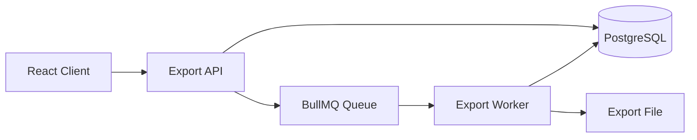

# Asynchronous Export Pipeline

PDF, CSV, and Excel exports are processed asynchronously.

Large or potentially expensive export operations are not performed directly inside the HTTP request.



The lifecycle is:

```
PENDING
   │
   ▼
PROCESSING
   │
   ├──→ COMPLETED
   │
   └──→ FAILED
```

The worker uses a concurrency limit and delegates format-specific generation to exporters.

Conceptually:

```
Export Worker
     │
     └── exportersByFormat
            ├── PDF exporter
            ├── CSV exporter
            └── Excel exporter
```

Errors are persisted on the export job and re-thrown so BullMQ can apply its retry behavior.

The frontend polls only while an export job is still in a non-final state and stops polling once all jobs are completed or failed.

## Limits

- **Export size limit.** Exports are limited to 20,000 responses because the worker builds files in memory; streaming exporters would remove the limit.
- CSV formula injection is neutralized (`=`, `+`, `-`, `@`, tab, CR); see [security.md](security.md).
- Cell format by type: ranking `1. First; 2. Second`, matrix `Row: Column; Row: Column`, “Other” `Other: text`, scales the raw number.
