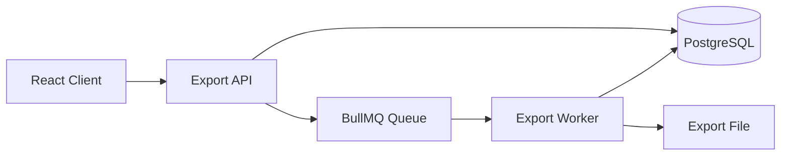

# Asynchronous Export Pipeline

PDF, CSV, and Excel exports are processed asynchronously.

Large or potentially expensive export operations are not performed directly inside the HTTP request.



The lifecycle is:

```
PENDING
   │
   ▼
PROCESSING
   │
   ├──→ COMPLETED
   │
   └──→ FAILED
```

The worker uses a concurrency limit and delegates format-specific generation to exporters.

Conceptually:

```
Export Worker
     │
     └── exportersByFormat
            ├── PDF exporter
            ├── CSV exporter
            └── Excel exporter
```

Errors are persisted on the export job and re-thrown so BullMQ can apply its retry behavior.

The frontend polls only while an export job is still in a non-final state and stops polling once all jobs are completed or failed.

## Limits

- **Export size limit.** Exports are limited to 20,000 responses because the worker builds files in memory; streaming exporters would remove the limit.
- CSV formula injection is neutralized (`=`, `+`, `-`, `@`, tab, CR); see [security.md](security.md).
- Cell format by type: ranking `1. First; 2. Second`, matrix `Row: Column; Row: Column`, “Other” `Other: text`, scales the raw number. A calculation field has a column like any question: a number is exported raw (no prefix, no grouping, so a spreadsheet can sum it), a text as is, a yes/no as Так / Ні; a value that could not be computed is an empty cell.
- **Scores.** When the form scores (or any response was scored, even if scoring was switched off later), CSV and Excel get three more columns after the answers: "Бали" (the total), "Максимум балів" and "Категорія результату" (the category's name; empty when the total fell in none or the category was deleted). In Excel the points are numbers, in CSV the category name goes through the formula guard like any other cell. In the PDF each response gets a line "Бали: 15 з 20 · Експерт". A form that never scored gets no extra columns.
